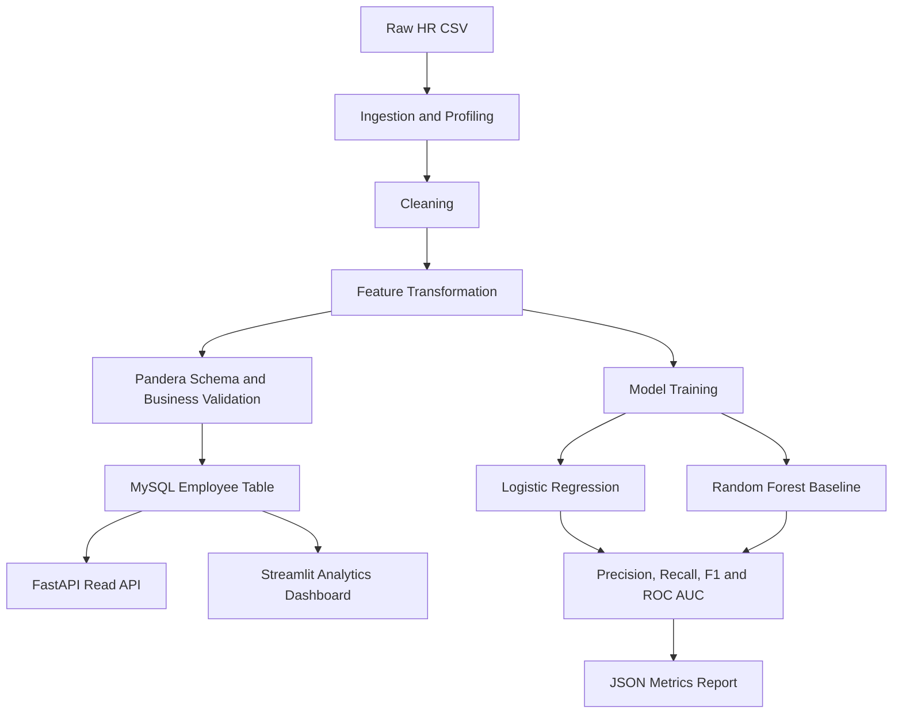

# Employee Attrition Analytics & Prediction Pipeline

An end-to-end workforce analytics project that ingests employee data, validates data quality, transforms workforce features, loads records into MySQL, and trains baseline machine-learning models to identify employees at risk of attrition.

This project demonstrates Python, Pandas, SQL, ETL engineering, data validation, scikit-learn, FastAPI, Streamlit, automated testing and reproducible development practices.

## Business use case

HR and workforce analytics teams need reliable employee data to understand attrition patterns and identify factors associated with employees leaving an organization. This project builds a repeatable data pipeline and baseline classification models. Model predictions are decision-support signals only; they should not be used as the sole basis for employment decisions.

## Dataset and schema

The project is designed for the IBM HR Analytics Employee Attrition & Performance dataset, commonly distributed through Kaggle. The raw dataset is not committed to this repository. Obtain the dataset from its original distribution and place the CSV at:

`data/raw/WA_Fn-UseC_-HR-Employee-Attrition.csv`

If your downloaded file has a suffix such as `(1)` or ` 2`, rename it to the exact filename above or update the configured path in `backend/transformation/clean_data.py`.

Important fields include:

| Field | Meaning |
|---|---|
| EmployeeNumber | Employee identifier |
| Age | Employee age |
| Attrition | Whether the employee left (Yes/No); prediction target |
| Department | Employee department |
| JobRole | Employee job role |
| MonthlyIncome | Monthly income |
| TotalWorkingYears | Total career experience |
| YearsAtCompany | Tenure at the organization |
| YearsInCurrentRole | Time in current role |
| OverTime | Whether overtime is recorded |

The source data contains personal/workforce attributes. Treat it as sample research data, keep it local where possible, and do not upload real employee data to public services.

## Architecture



## Pipeline stages

1. **Ingestion and profiling:** inspect dimensions, columns, data types, missing values, duplicates and business-rule anomalies.
2. **Cleaning:** remove duplicate rows and constant columns.
3. **Transformation:** standardize categorical values and create `TenureGroup` and `ExperienceGroup`.
4. **Validation:** check required fields, types, nulls, uniqueness, value ranges and workforce business rules. A reusable Pandera schema is in `backend/validation/schema.py`.
5. **Loading:** load transformed records into MySQL and compare source and target row counts.
6. **Analytics:** expose employee data through FastAPI and visualize workforce metrics in Streamlit.
7. **Prediction:** train Logistic Regression and Random Forest baselines using a stratified train/test split.

## Machine-learning evaluation

The target is `Attrition`, mapped to `Yes = 1` and `No = 0`. The training script reports metrics for the positive/leaver class, not just overall accuracy:

- Precision for Attrition=Yes
- Recall for Attrition=Yes
- F1-score for Attrition=Yes
- ROC AUC
- Confusion matrix

The training pipeline uses a preprocessing pipeline for missing-value imputation, numeric scaling and categorical one-hot encoding. The split is stratified and uses a fixed random seed for reproducibility. Class weighting is enabled for the baseline classifiers to address class imbalance.

**No model scores are claimed in this README.** Generate the actual metrics using the command below; results are written to `reports/models/baseline_metrics.json`. Use those measured values when describing model performance in interviews.

## Repository structure

```text
employee-attrition-pipeline/
├── backend/
│   ├── api/                  # FastAPI endpoints
│   ├── database/             # SQLAlchemy MySQL connection
│   ├── ingestion/            # Data profiling and MySQL loading
│   ├── transformation/       # Cleaning and feature engineering
│   ├── validation/           # Data quality and Pandera schema
│   ├── modeling/             # Attrition baseline models
│   └── run_pipeline.py       # End-to-end pipeline entry point
├── data/                     # Local raw and processed data (not committed)
├── docs/                     # QA plans and reconciliation documentation
├── frontend/dashboard/       # Streamlit dashboard
├── reports/                  # QA evidence and generated model metrics
├── sql/                      # Validation SQL and read-only account script
├── tests/                    # Automated tests
├── Dockerfile
├── docker-compose.yml
└── requirements.txt
```

## Local setup

### 1. Clone and create a virtual environment

```bash
git clone https://github.com/saigreeshmakota/employee-attrition-pipeline.git
cd employee-attrition-pipeline
python3 -m venv .venv
source .venv/bin/activate
pip install -r requirements.txt
```

Python 3.11 or later is recommended for the current dependency set.

### 2. Add the dataset

Create the local data directories if needed:

```bash
mkdir -p data/raw data/processed
```

Place the downloaded CSV at the path described in the Dataset section. Dataset files are ignored by Git and should not be committed.

### 3. Configure MySQL

Create a local `.env` file using `.env.example` as a reference. Configure your own MySQL host, port, username, password and database. Ensure the target database exists before running the MySQL load stage.

Example:

```env
DB_USER=your_mysql_username
DB_PASSWORD=your_mysql_password
DB_HOST=localhost
DB_PORT=3306
DB_NAME=employee_attrition_db
```

Never commit `.env` or credentials.

### 4. Run the full pipeline

From the repository root:

```bash
python -m backend.run_pipeline
```

The pipeline runs profiling, cleaning, transformation, validation, MySQL loading and baseline model training in order. It stops if a stage fails.

If you want to run individual stages:

```bash
python -m backend.ingestion.load_data
python -m backend.transformation.clean_data
python -m backend.transformation.transform_data
python -m backend.validation.validate_data
python -m backend.ingestion.load_to_mysql
python -m backend.modeling.train_attrition
```

The MySQL loading step intentionally stops if the target table already contains rows, to avoid accidental duplicate inserts. For a fresh experiment, use a separate test database or deliberately reset the table after backing up any data you need.

## Run the API and dashboard

Start the API:

```bash
python -m uvicorn backend.api.main:app --reload
```

API documentation: http://127.0.0.1:8000/docs

Start the dashboard in another terminal:

```bash
python -m streamlit run frontend/dashboard/app.py
```

The API and dashboard require a populated MySQL database.

## Docker Compose

Copy `.env.example` to `.env` and set strong local passwords. Start MySQL:

```bash
docker compose up -d mysql
```

The pipeline image expects the raw CSV in `data/raw/`. Run the pipeline service after MySQL is healthy:

```bash
docker compose --profile pipeline run --rm pipeline
```

Compose maps MySQL to host port 3307 to avoid colliding with a local MySQL service on 3306. The container connects to MySQL using the internal service hostname.

## Read-only SQL account for the Knowledge Copilot

A least-privilege account script is provided at `sql/create_copilot_readonly_user.sql`. Review and edit the database name, password and allowed host before executing it as a MySQL administrator.

The intended account has SELECT access only to the employee table. Use this separate account for the future Copilot SQL agent; never give an LLM agent the application's write credentials or MySQL root credentials. Enforce SELECT-only SQL validation in the Copilot application as a second layer of protection.

## Tests and CI

Run the deterministic schema and modeling unit tests:

```bash
pytest -q tests/test_portfolio_quality.py
```

Run Ruff:

```bash
ruff check backend tests --select E4,E7,E9
```

GitHub Actions runs these focused checks on every push and pull request. The older integration tests in `tests/test_api.py`, `tests/test_etl.py` and `tests/test_data_quality.py` rely on local processed CSV files and/or a running MySQL database; they are not included in the lightweight CI job yet.

## Existing QA evidence

The repository contains earlier QA artifacts, including HTML test reports, SQL validation output and source-to-target reconciliation documentation. The previous local test run recorded in the project history reported 22 passed tests and 7 API tests passed. These are historical local results, not a claim that every test currently runs on a clean CI runner. Re-run the tests in your environment before presenting fresh results.

## Limitations and next improvements

- The IBM HR dataset is a small, historical sample and may not represent a current workforce.
- The model is a baseline, not a validated HR decision system. Assess fairness, calibration, drift and business impact before any real-world use.
- The current ETL uses local CSV files and a single MySQL target; production ingestion would need scheduling, idempotency, schema migration and observability.
- The API currently returns a limited employee sample and should gain authentication, pagination and role-based access before deployment.
- The read-only SQL account script is a starting point; restrict host access and rotate credentials for deployment.
- Add integration tests with disposable MySQL containers and test the complete Docker workflow in CI.
- Add model explainability and subgroup/fairness evaluation before considering operational use.

## License

Add the repository's chosen open-source license before redistributing the code or dataset. The dataset itself may have separate terms from this source code.
